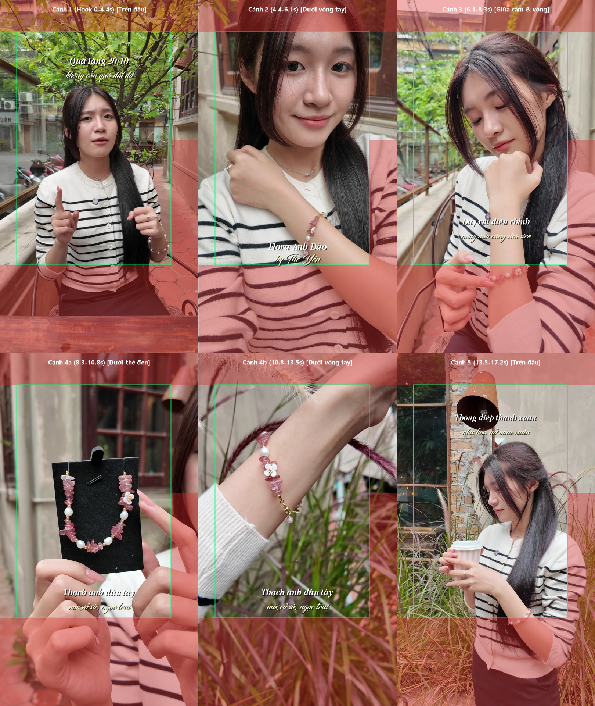
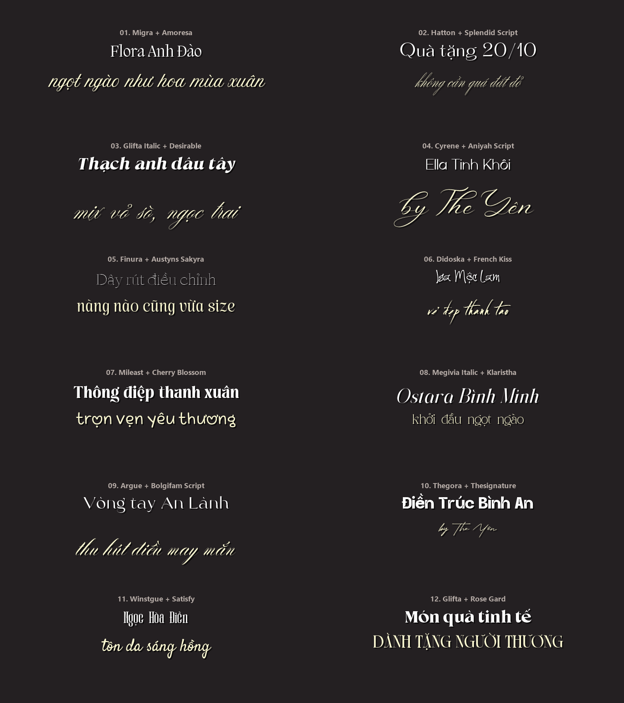
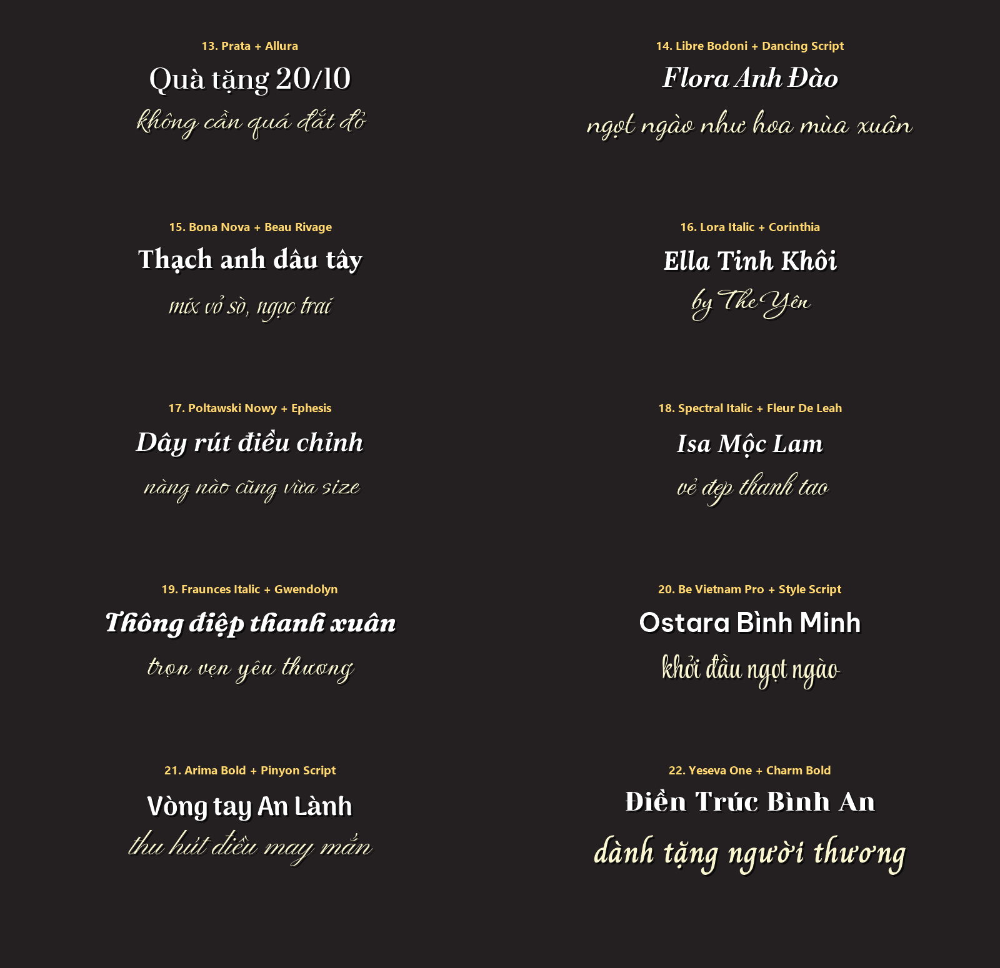

# Skill Edit Video Vòng Tay "The Yên" (`skill-edit-video-the-yen`)

Bộ A.I Skill tự động dựng video ngắn TikTok / Reels / Shorts (`1080×1920`, `30 fps`) cho dòng sản phẩm Vòng Tay & Trang Sức Phong Thủy/Thời Trang theo DNA **"The Yên"** trực tiếp vào **Multi-Timeline CapCut PC (Windows)**.

---

## Điểm Nổi Bật (7 Nguyên Tắc Vàng)

1. **100% Điểm cắt gắn Chuyển cảnh Lấp lánh (`Sparkle Transitions`):**
   - Mọi điểm cắt giữa các phân đoạn B-Roll (`N - 1` điểm cắt) đều được gắn tự động hiệu ứng thuộc nhóm **Lấp lánh** của CapCut (`Lấp lánh mờ`, `Biến hình lấp lánh`, `Lấp lánh`, `Mờ kim sa`, `Mờ lấp lánh`, `Thu phóng lấp lánh` — `0.5s`) giúp tôn độ bắt sáng của đá tự nhiên, vỏ sò, ngọc trai và charm bạc.
2. **Cỡ chữ cân đối & Chống tràn màn hình tuyệt đối (`48% – 62%` chiều ngang):**
   - Cấu trúc chữ **Cặp 2 Dòng (Dual-Track Text Overlay)**:
     - **Dòng 1 (`Track 2`):** Font tiêu đề (Luxury Serif / Display hoặc Chữ viết thường thanh lịch), màu vàng kem ấm `#F9DE90`, viền nâu trầm `#583D27` (`width = 0.08`).
     - **Dòng 2 (`Track 3`):** Font chữ ký / chữ viết tay mềm mại (Script / Handwritten), màu trắng `#FFFFFF` kèm đổ bóng dịu.
   - Tự động đo độ rộng pixel thực tế bằng `System.Drawing.Graphics.MeasureString` để cân chỉnh `font_size` (`11–15`) và `clip.scale` (`1.02–1.45`), đảm bảo chữ không bao giờ bị tràn màn hình hay tự ngắt dòng.
3. **Nằm gọn trong Khung An Toàn TikTok (`TikTok Safe Zone`):**
   - Tránh hoàn toàn vùng chết đỉnh (`Y > +0.82`), vùng chết đáy chứa giỏ hàng TikTok Shop + caption (`Y < -0.50`) và cột nút tương tác bên phải (`X > +0.72`).
4. **Tuyệt đối KHÔNG che mặt mẫu & KHÔNG che sản phẩm (`Zero Occlusion`):**
   - Tự động trích xuất frame từng phân cảnh bằng `ffmpeg` và chọn vùng đặt chữ thông minh (`Upper Safe Zone` phía trên đầu mẫu `Y1=+0.66, Y2=+0.57`, `Lower Safe Zone` phía dưới vòng tay `Y1=-0.39, Y2=-0.47`, hoặc `Mid-Lower Gap` `Y1=-0.25, Y2=-0.34`), xuất ảnh kiểm duyệt trực quan `safezone-composite.png`.
5. **Đi kèm Kho 22 Bộ Font Việt Hóa Cách Điệu & Viết Tay (48 file `.ttf` trong `assets/fonts/`):**
   - Kiểm định 100% dấu tiếng Việt không lỗi ô vuông hay nhảy font.
   - Cài đặt tự động chỉ với 1 lệnh: `powershell -ExecutionPolicy Bypass -File .\scripts\install-fonts.ps1`.
6. **Can thiệp trực tiếp Multi-Timeline CapCut PC & Chống ghi đè RAM:**
   - Tự động khởi tạo/cập nhật `Timelines\<UUID>\draft_content.json` (`UTF-8 no BOM`), đăng ký vào `project.json`, `timeline_layout.json`, `draft_biz_config.json` và chạy Daemon bảo vệ RAM.
7. **Chuẩn Kịch bản 5 Nhịp Chuyển Đổi Cao:**
   - `Emotional Hook (0–4s)` → `Product Hero & Dây rút vừa size (4–8s)` → `Chất liệu đá & Charm (8–14s)` → `Thông điệp thanh xuân/bình an (14–18s)` → `Packaging hộp quà & CTA (18–24s)`.

---

## Hình Ảnh Minh Họa Trong Bộ Skill

### 1. Kiểm duyệt Khung An Toàn TikTok & Chống che mặt mẫu / sản phẩm


### 2. Bảng 22 Bộ Font Việt Hóa (`Bộ 01` → `Bộ 12` & `Bộ 13` → `Bộ 22`)



---

## Cấu Trúc Thư Mục

```text
skill-edit-video-the-yen/
├── SKILL.md                                # Tài liệu điều phối chính cho A.I Agent
├── README.md                               # Hướng dẫn tổng quan
├── agents/
│   └── openai.yaml                         # Khai báo giao diện kích hoạt $skill-edit-video-the-yen
├── config/
│   ├── local-config.example.json           # Tọa độ TikTok Safe Zone, mã màu, 6 mã Sparkle Transitions
│   └── font-pairings-catalog.json          # Danh mục 22 cặp Font Việt hóa (Bộ 01 -> Bộ 22)
├── references/
│   ├── style-blueprint.md                  # Bản thiết kế phong cách dựng "The Yên"
│   ├── font-catalog-22-sets.md             # Chi tiết 22 bộ font Việt hóa cách điệu & viết tay
│   ├── capcut-json-architecture.md         # Kiến trúc JSON Multi-Timeline CapCut PC
│   └── acceptance-checklist.md             # Checklist 6 hạng mục nghiệm thu chất lượng
├── scripts/
│   ├── install-fonts.ps1                   # Cài đặt tự động 48 font Việt hóa vào Windows & Registry
│   ├── build-capcut-timeline.ps1           # Dựng Timeline CapCut từ edit-plan.json
│   ├── verify-safezone-and-width.ps1       # Xuất ảnh kiểm duyệt Safe Zone & chống che mặt/sản phẩm
│   └── protect-capcut-project.ps1          # Daemon bảo vệ chống CapCut ghi đè RAM khi đóng Project
└── assets/
    ├── edit-plan.example.json              # Kế hoạch dựng mẫu (Flora - KB 04)
    ├── font-pairings-01-12-preview.png     # Ảnh xem trước Bộ 01 -> Bộ 12
    ├── font-pairings-13-22-preview.png     # Ảnh xem trước Bộ 13 -> Bộ 22
    ├── safezone-composite-example.png      # Ảnh kiểm duyệt Safe Zone mẫu
    └── fonts/                              # Toàn bộ 48 file .ttf Việt hóa
```
